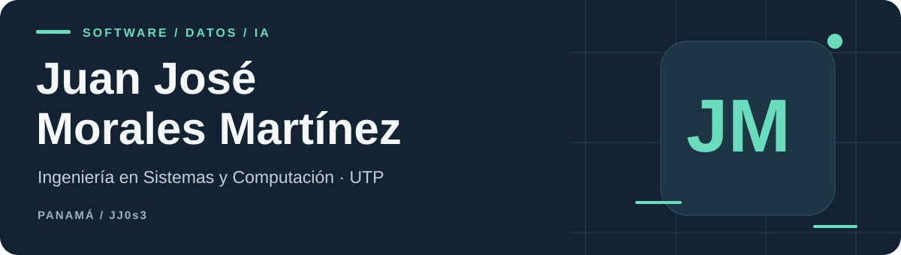
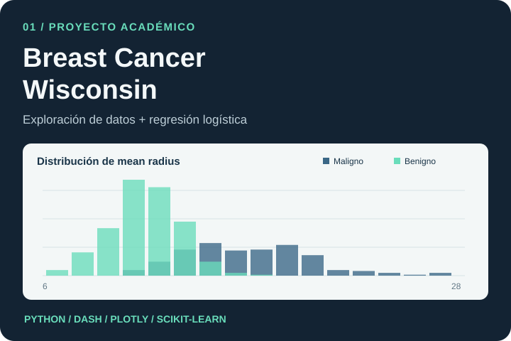
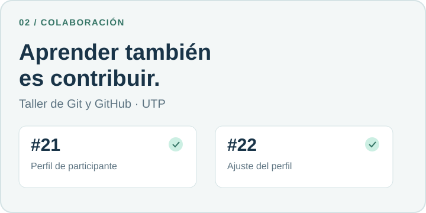

  <a href="https://www.linkedin.com/in/jmorales200304/">LinkedIn</a> &nbsp;·&nbsp;
  <a href="#proyecto-seleccionado">Proyecto seleccionado</a> &nbsp;·&nbsp;
   &nbsp;·&nbsp;
  <a href="https://github.com/JJ0s3?tab=repositories">Repositorios</a>

## Sobre mí

Soy **Juan José Morales Martínez**, estudiante de **Ingeniería en Sistemas y Computación** en la **Universidad Tecnológica de Panamá**. Me interesan el desarrollo de software, el análisis de datos y la inteligencia artificial.

Me gusta entender el problema, construir una solución y explicar cómo funciona. En este perfil comparto trabajo académico y contribuciones que permiten explorar mi código, mis decisiones y lo que estoy aprendiendo.

**Panamá** · Miembro de **IEEE Computer Society — UTP**

## Proyecto seleccionado

<table>
<tr>
<td width="46%" valign="middle">

</td>
<td width="54%" valign="top">
<h3>Dashboard de análisis de datos</h3>

<em>Breast Cancer Wisconsin · Proyecto académico</em>

Una aplicación interactiva para explorar un dataset público y entender cómo cambia la clasificación al ajustar el umbral de una regresión logística.

<ul>
<li>Histogramas, boxplots y correlaciones.</li>
<li>Separación de entrenamiento y prueba con escalado.</li>
<li>Matriz de confusión y curva ROC.</li>
</ul>

<code>Python</code> <code>pandas</code> <code>Dash</code> <code>Plotly</code> <code>scikit-learn</code>

<a href="https://github.com/JJ0s3/tarea3-dashboard-breast-cancer">Código y documentación</a> · <a href="https://github.com/JJ0s3/tarea3-dashboard-breast-cancer/pull/1">Mejoras integradas</a>

</td>
</tr>
</table>

Ejercicio educativo, sin validación para uso clínico. La ilustración utiliza datos del dataset público; no es una captura de la aplicación. Las correcciones ROC, las pruebas y la presentación adaptable se integraron en main mediante el PR #1.

## Colaboración

<table>
<tr>
<td width="46%" valign="middle">

</td>
<td width="54%" valign="top">
<h3>Taller de Git y GitHub — UTP</h3>

Práctica de colaboración mediante ramas, commits y pull requests en un proyecto compartido.

Mi aportación consistió en añadir y ajustar el perfil de participante; el sitio y su infraestructura pertenecen al proyecto original.

<a href="https://github.com/jamesrhurtado/skills-git-and-github-workshop-utp/pull/21">PR #21 · Perfil de participante</a> 
<a href="https://github.com/jamesrhurtado/skills-git-and-github-workshop-utp/pull/22">PR #22 · Ajuste del perfil</a>

<code>Git</code> <code>GitHub</code> <code>Pull requests</code>

</td>
</tr>
</table>

## Tecnologías y aprendizaje

| Área | Herramientas |
| :-- | :-- |
| **Análisis y modelos · código publicado** | Python · pandas · NumPy · scikit-learn |
| **Visualización · código publicado** | Dash · Plotly |
| **Colaboración · contribuciones integradas** | Git · GitHub |
| **Formación y práctica académica** | C# · Windows Forms · programación orientada a objetos · SQL |

Los enlaces de este perfil muestran la evidencia pública disponible. Sigo ampliando la documentación de mis proyectos académicos de software e inteligencia artificial.

---

<strong>Conversemos sobre software y datos.</strong> 
<a href="https://www.linkedin.com/in/jmorales200304/">LinkedIn</a> · <a href="https://github.com/JJ0s3?tab=repositories">Explora mis repositorios</a>

